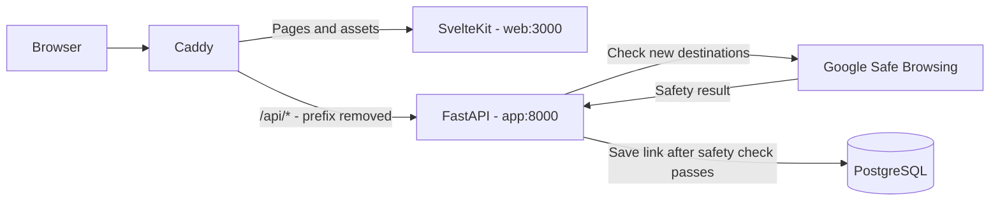

# URL Shortener

A full-stack URL shortening application built with SvelteKit, FastAPI, and PostgreSQL. Users can create generated or custom short links, inspect destinations, and follow redirects. An admin page provides link management and click counts.

## Architecture

Caddy is the shared entry point. It forwards page requests to SvelteKit and `/api/*` requests to FastAPI after removing `/api`. The browser uses relative API URLs, keeping frontend and backend requests on the same origin. Containers communicate using Compose service names.

### Request flow

1. **Create:** the frontend submits a destination and optional custom code. FastAPI validates the input and checks Google Safe Browsing before inserting the link. A database unique constraint resolves competing inserts; generated codes are retried on conflict.
2. **Resolve:** `/api/{short_code}` atomically increments clicks and returns a 302 redirect. The frontend also provides `/{short_code}` as a browser-based resolver. Destination inspection increments the same counter.
3. **Manage:** `/admin` lists links and supports filtering, copying, testing, seeding, and deletion.

### Components

| Component | Responsibility |
| --- | --- |
| [web](web/README.md) | SvelteKit pages, shared components, and browser API client |
| [app](app/README.md) | FastAPI routes, validation, safety checks, and database transactions |
| PostgreSQL | Destinations, unique short codes, creation times, and click counts |
| [caddy](caddy/) | Reverse proxy and production TLS termination |
| [docker-compose.prod.yml](docker-compose.prod.yml) | Production stack with commit-tagged images, service health checks, secrets, and persistent storage |
| [.github/workflows/deploy.yml](.github/workflows/deploy.yml) | Container builds, GHCR publishing, and EC2 deployment |

SQLAlchemy manages database access. Inserts use conflict handling, and click counters use an atomic update to avoid lost increments during concurrent requests. PostgreSQL data persists outside application containers. 
